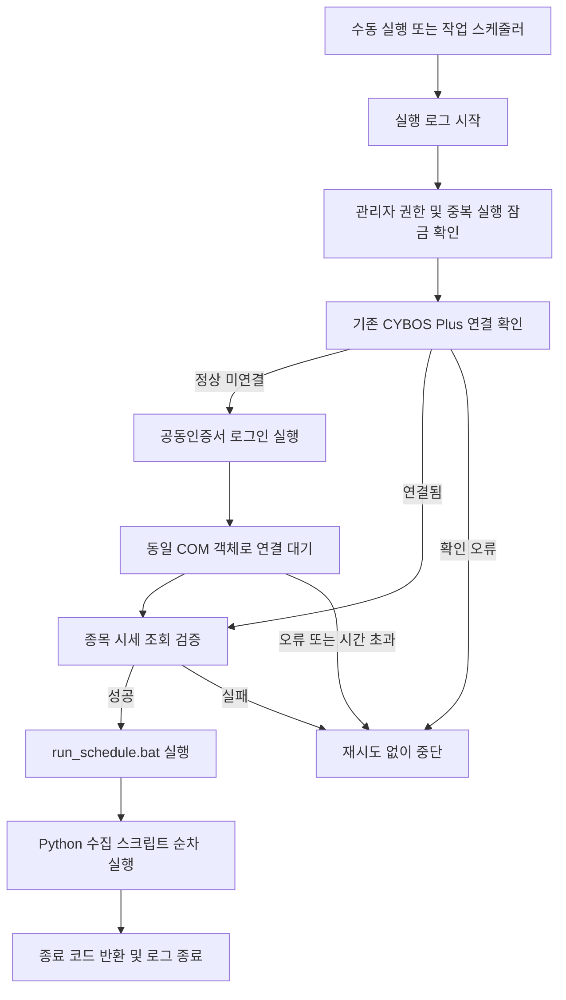

# 작업 내역

기준일: 2026-10-25

## 1. 목적과 범위

Windows PC에서 Rust 실행기가 CYBOS Plus의 공동인증서 로그인과 API 연결을 확인한 뒤,
기존 Python 주식 데이터 수집 배치를 실행하도록 구성했다. 주문 API는 사용하지 않는다.

| 항목 | 경로·값 |
|---|---|
| Rust 프로젝트 | `C:\myprojects\study\dashin_auto_login` |
| 수집기 프로젝트 | `C:\myprojects\study\kr_stocks_dashin_collector` |
| CYBOS 실행기 | `C:\DAISHIN\STARTER\ncStarter.exe` |
| Rust 빌드 대상 | `i686-pc-windows-msvc` |
| 수집 진입점 | 수집기 폴더의 `run_schedule.bat` |
| 예약 작업 기본 이름 | `Daishin-CYBOS-Collect` |

## 2. 현재 구조

`login`은 시세 검증까지만 수행하고, `run`은 그 다음 배치 실행까지 수행한다.

## 3. 구현한 기능

| 기능 | 구현 내용 |
|---|---|
| 환경 진단 | 32비트, 관리자 권한, 실행기 경로, COM 객체 생성 확인 |
| API 연결 확인 | `CpUtil.CpCybos.IsConnect` 조회 |
| 공동인증서 로그인 | `/prj:cp /logintab:cert /pwdcert:... /autostart` 전달 |
| 인증정보 | `CYBOS_CERT_PASSWORD`만 사용, 프로세스 환경 우선·사용자 영구 환경변수 대체 조회 |
| 시세 검증 | `DsCbo1.StockMst`의 응답 상태·종목코드·종목명·양수 가격 확인 |
| 기존 연결 선택 | 신뢰한 CYBOS 프로세스의 단일 `cp` 행과 서버·버튼을 식별할 때만 기존 연결 선택 |
| 시간 제한 | COM worker를 분리하여 연결 확인·대기·시세 호출의 무한 대기 방지 |
| 수집기 연동 | 배치 폴더를 작업 디렉터리로 지정, 배치 종료까지 대기, 종료 코드 반환 |
| 중복 실행 차단 | Windows 이름 있는 뮤텍스로 `login`과 `run` 동시 실행 차단 |
| 파일 로그 | 콘솔을 유지하며 표준 출력·오류·최종 종료 코드를 실행별 UTF-8 로그에 기록 |
| 수집기 실패 전달 | 하위 스크립트 오류를 예외·비정상 종료 코드로 상위에 전달 |
| 예약 등록 | 평일·대화형 사용자·최고 권한·중복 무시 정책의 작업 등록 스크립트 |

ID와 로그인 비밀번호를 함께 입력하던 초기 방식은 인증서 비밀번호만 사용하는 방식으로
변경했다. 사용할 인증서는 CYBOS 로그인 화면에서 미리 선택해야 한다.

## 4. 주요 파일

| 파일 | 역할 |
|---|---|
| `src/main.rs` | CLI, 로그인·연결·수집 실행 흐름 |
| `src/cybos.rs` | COM 호출, 연결 대기, 시세 검증 |
| `src/credentials.rs` | 환경변수 조회, 자식 프로세스 인증정보 상속 제거 |
| `src/connection_popup.rs` | 기존 연결 선택, CPUTIL·CPSTART 오류 감지 |
| `src/collector.rs` | 배치 경로 검증과 실행 |
| `src/single_instance.rs` | 실행 잠금 |
| `src/logging.rs` | 콘솔·파일 출력 수집과 알려진 인증서 비밀번호 마스킹 |
| `scripts/Set-CybosEnvironment.ps1` | 비밀번호 숨김 입력과 사용자 환경변수 저장 |
| `scripts/Apply-CollectorFix.ps1` | 검토한 수집기 수정본의 해시 검증·원본 백업·적용 |
| `scripts/Register-CollectionTask.ps1` | 예약 작업 미리보기·등록·변경 |
| `collector_fix/` | 수집기 프로젝트에 적용할 여섯 파일의 수정본 |

수집기 폴더는 개발 세션의 쓰기 허용 범위 밖이어서 직접 수정하지 않고 적용 스크립트를
제공했다. 사용자가 수정본 적용 후 정상 종료를 보고했다.

## 5. 오류와 변경 이력

### 실행기 종료 코드 2

초기에는 `ncStarter.exe`의 비정상 종료 코드를 즉시 로그인 실패로 처리했다. 실행기 종료와
실제 API 연결 완료는 시점이 다를 수 있어, 최종 판정은 COM 연결과 시세 응답으로 변경했다.
종료 코드 2 자체의 CYBOS 내부 의미는 확정하지 않았다.

### 기존 연결 선택 팝업

이미 존재하는 연결을 재사용할지 묻는 창이 수집 배치 실행 전에 나타났다. UI Automation으로
단일 CYBOS Plus 연결만 선택하는 감시 기능을 추가했다. 복수 연결·지원하지 않는 UI에서는
임의 선택하지 않는다. 실제 UI 구조 전체에 대한 독립적인 재현 검증은 남아 있다.

### Sign On Error 및 서버 IP 읽기 실패

서버 접속 실패, `CPUTIL` 및 `CPSTART`의 ‘서버 IP 읽기 실패’ 팝업이 보고되었다.
한 차례 TCP 연결과 DNS 조회는 성공했지만, 이것이 CYBOS 로그인 정상성을 증명하지는 않는다.

오류를 준비 중 상태로 간주하고 확인을 반복했던 처리는 팝업 반복을 유발할 수 있었다.
다음과 같이 수정했다.

- 로그인 대기에는 하나의 COM 객체와 worker를 유지한다.
- 서버 IP 읽기 오류는 정상 미연결 상태와 구분하고 즉시 중단한다.
- 자체 worker만 종료하며, 외부 CYBOS 프로세스를 임의로 강제 종료하지 않는다.
- 오류가 남아 있으면 새 COM 확인을 시작하지 않도록 감지한다.

사용자는 재부팅 후 수동 로그인, Rust 연결·조회 확인, 수집 실행이 정상 종료됐다고 보고했다.
서버 IP 오류의 근본 원인은 확정되지 않았으며 재부팅을 코드 문제의 해결 근거로 보지 않는다.

### 수집 실패가 정상 종료로 전달되던 문제

기존 `daily_runner.py`와 하위 수집 스크립트의 일부 오류 처리에서 실패를 출력한 뒤
`return`하여 종료 코드 0이 반환됐다. 수정본은 연결·통신·DB 오류를 전달하고 첫 실패에서
후속 수집을 중단한다. 이미 커밋된 이전 단계의 데이터까지 전체 롤백하지는 않는다.

### 프로그램 매매 COM 예외 판별

`PgAtime8112.GetDataValue` 오류에서 외부 HRESULT는 `-2147352567`이지만 내부
`excepinfo[5]`는 `-2147024809`인 사례가 있었다. 외부 코드만 검사하던 수정이 원인을
놓쳤다. 두 위치를 검사하고, 정상 행을 읽은 후 다음 행의 시간 필드에서 발생한
E_INVALIDARG만 기존 데이터 끝 처리로 허용하도록 좁혔다.

첫 행 실패·다른 필드 오류·다른 HRESULT는 계속 실패로 전달한다. API의 헤더 인덱스와
필드 의미 전체를 검증한 것은 아니며, 사용자는 이 수정 이후 정상 종료를 보고했다.

## 6. 검증 결과와 한계

| 항목 | 확인 근거·상태 |
|---|---|
| Rust 빌드·포맷·Clippy | 개발 세션에서 통과 |
| Rust 테스트 | 최근 실행 11개 통과; 잠금·복구·출력 캡처·종료 코드·오류 후 중단 등 |
| Python 테스트 | 최근 실행 11개 통과; 모의 COM·DB·프로세스·알림 사용 |
| 수집기 적용 스크립트 | 프로젝트 안의 테스트 복사본으로 해시 검증·백업·적용 확인 |
| 인증서 자동 로그인 | 사용자 성공 보고 |
| 재부팅 후 연결·조회·수집 | 사용자 정상 종료 보고 |
| 프로그램 매매 예외 수정 후 수집 | 사용자 정상 종료 보고 |
| 예약 작업 XML | 평일·대화형·최고 권한·중복 무시 설정, Preview·WhatIf 검증 |
| 실제 예약 등록 | 사용자 등록 스크립트 실행 보고; 등록 상태·시각은 별도 확인 필요 |
| 첫 예약 시각의 자동 실행 | 결과 미확인 |
| 미로그인 상태에서 로그인부터 수집까지 | 최신 버전의 전체 흐름 검증 필요 |
| 잠금 화면·RDP 종료·Windows 로그오프 | 별도 운영 검증 필요; 로그오프 무인 실행은 지원 전제로 삼지 않음 |

개발 중 실제 수집·DB 변경·Telegram 전송은 테스트로 실행하지 않았다. 사용자 실행 결과와
모의 테스트 결과를 구분한다. 문서 작성 단계에서 로그인이나 수집을 재실행하지 않았다.

## 7. 남은 작업

1. 작업 스케줄러에서 실제 등록 시각·실행 계정·최고 권한·다음 실행 시간 확인.
2. 첫 예약 실행의 로그·종료 코드·DB 결과 확인.
3. CYBOS 미로그인 상태의 최신 버전 전체 흐름 검증.
4. 잠금 화면과 RDP 사용 등 실제 PC 운용 조건 검증.
5. 필요 시 로그 보관 기간·공휴일 처리·실패 알림 정책 추가.

## 8. 참고 자료

- [대신증권 Plus FAQ](https://money2.daishin.com/e5/mboard/ptype_accordion/plusFAQ/DW_Basic_List.aspx?boardseq=298&m=9508&p=8835)
- [대신증권 자동 로그인 안내](https://money2.daishin.com/e5/mboard/ptype_basic/Basic_018/DW_Basic_Read_Page.aspx?boardseq=60&m=9508&p=8827&page=1&searchString=&seq=19758&v=8636)
- [Microsoft 예약 작업 실행 계정](https://learn.microsoft.com/en-us/powershell/module/scheduledtasks/new-scheduledtaskprincipal)

공동인증 탭 지정 옵션 `/logintab:cert`는 설치 실행기의 처리 문자열을 근거로 적용했고
사용자 성공 보고가 있다. 위 공식 자동 로그인 안내가 이 옵션까지 보장하는 것은 아니다.
